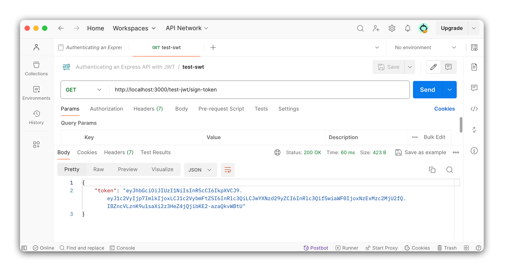
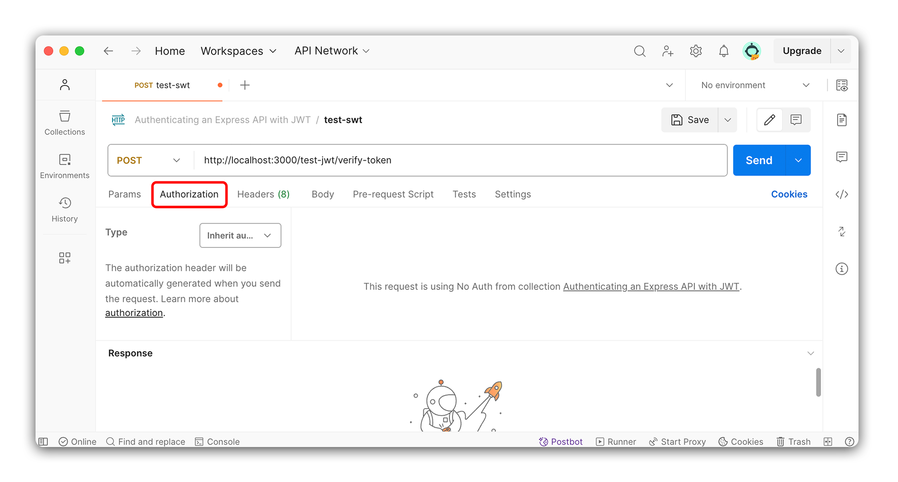
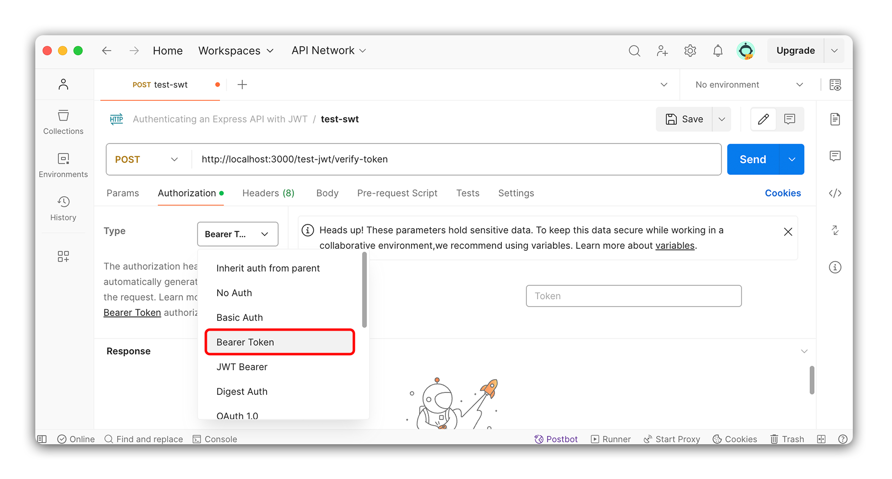

# 

**Learning objective:** By the end of this lesson, students will be able to explain how JSON Web Tokens use signing and verifying to authenticate users in a Flask application.

## JSON Web Tokens (JWT) in Flask

Before creating routes to handle signing up and signing in users, let's look at how we can use JSON Web Tokens (JWT) in an Flask application.

We'll start by installing the `pyjwt` package to handle all JSON Web Token functionality. You can find the docs [here](https://pyjwt.readthedocs.io/en/stable/)

```bash
pipenv install pyjwt
```

JWTs are a way to securely transmit information between parties as a JSON object. This information can be verified and trusted because it is digitally signed. JWTs can be signed using a secret (with the `HMAC` algorithm) or a public/private key pair using `RSA` or `ECDSA`.

> 💡 No need to know what `HMAC`, `RSA`, or `ECDSA` are. Just know that they are different algorithms used to sign JWTs.

We don't have to know exactly how JWTs are created and verified, but we still need to know how to use them in our application.

Using JWTs breaks down into two actions:

- **Signing**: Creating a JWT and sending it to the client.
- **Verifying**: Receiving a JWT from the client and verifying it.

In this lesson, we will create routes to handle these two actions, as a demonstration of how to use JWTs in Flask. These routes **will not appear in the final application**, and should only be used for improving your conceptual understanding of JWTs in Flask.

## Signing a JWT

Let's add a new route to our `app.py` file with the following characteristics:

- Route: `/sign-token`
- Method: `GET`
- Response: `{ message: 'You are authorized!' }`

```python
# add an import for jsonify
from flask import Flask, jsonify

@app.route('/sign-token', methods=['GET'])
def sign_token():
    return jsonify({ "message": "You are authorized!"})
```

Open up Postman and make a GET request to `http://localhost:5000/sign-token`. The response should show the message `You are authorized!`. Make sure you can see the message before you move on.

Now that we have a route that sends a test message, let's dive into the JWT signing process. The `pyjwt` package has a method called `encode` that we can use to create a JWT. We will use this method to create a JWT and send it to the client.

The `encode` method takes three arguments:

1. The payload to be included in the JWT.
2. The secret key to sign the JWT with.
3. A list of algorithms to use when encoding (default is algorithms=["HS256"])

The **payload** is the information we want to include in the JWT. This can be any JSON object. We want to specify that this token belongs to a specific user and no one else. For now, we will include a mock user object with a `username`, `password`, and `id` field.

The **secret key** is a string used to sign the JWT. This key is unique to our application and should be kept secret.

Now that we've seen the `encode` method, it's time to use it in our `/sign-token` route!

Remove the `res.json` method from the route and replace it with a mock user object:

```python
@app.route('/sign-token', methods=['GET'])
def sign_token():
# Mock user object added
    user = {
        "id": 1,
        "username": "test",
        "password": "test"
    }
    return jsonify(user)
```

This mock user object will be a stand-in for a user object that we would have in our database; we'll use it as the payload for our JWT.

We have our **payload**; now we must create the **secret key**.

First, create a `.env` file:

```bash
touch .env
```

And inside of it, add a new key-value pair for the secret key:

```bash
JWT_SECRET=supersecret
```

Before moving on, let's talk about the secret key. This key can be anything as long as it is a string. This could be as simple as the word `supersecret` or `catsarecool`; or as complex as `4inK]I+X+;n2+g"*>AMQc{p99)9DB@a@`. As the name implies, the key to the secret key should be secret and not shared or left in your code where someone would have access to view it. This is why we're storing it in the `.env` file, which **you should always be sure to include in your `.gitignore` file** to prevent it from surfacing on GitHub.

> 🧠 If you want a more secure secret key, you can use a password generator to create a random string of characters. Or, simply bash on your keyboard for a few seconds and use that as your secret key. Just remember to remove spaces.

Then, to access these environment variable, we'll need to import the `python-dotenv` package:

```python
# app.py

from dotenv import load_dotenv
import os
load_dotenv()
```

This will give us access to environment variables using the `os.getenv('variable_name')` method.

Next, let's make use of the `pyjwt` package and import `jwt`:

```python
# app.py

# Add an import for the jwt library:
import jwt
```

We now have everything we need for the `encode` method.

Pass both the mock user object and the secret key to the `sign` method and assign the result to a variable called `token`, and send that variable as the response:

```python
# app.py
@app.route('/sign-token')
def sign_token():
    user = {
        "id": 1,
        "username": "test",
        "password": "test"
    }
    token = jwt.encode(user, os.getenv('JWT_SECRET'), algorithm="HS256")
    # return token
    return jsonify({"token": token})
```

Send the token back to the client in the response:

Using Postman, make a GET request to `http://localhost:5000/sign-token`. You should see a response with a token in it. Make sure you can see the token before you move on.



We have successfully created a JWT and sent it to the client! We will use this token in the next lesson to verify the user.

## Verifying a JWT

Just like with the signing route, our **verifying route will not be a part of our finished application** and will just be used for testing and learning purposes.

Inside the `app.py` file create a new route to receive a POST request. This route should follow the structure below:

- Route: `/verify-token`
- Method: `POST`
- Response Body: `{ message: 'Token is valid' }`

```python
@app.route('/verify-token', methods=['POST'])
def verify_token():
    return jsonify({"message": "Token is valid."})
```

Using Postman, make a POST request to `http://localhost:5000/verify-token`.

In Postman, you should see a response with the following message:

```json
{
  "message": "Token is valid."
}
```

Make sure you can see the message before you move on.

Next, we'll use the `decode` method to verify the token. The `decode` method takes two arguments:

- The token to decode.
- The secret key to decode the token with.

We will use the `decode` method to decode the token we created in the previous route. We will also use the secret key created in the `.env` file.

To send the token to the server, we'll once again use Postman. Open Postman and copy the token you were sent in the previous route. If you have lost that token, just send another request to the same test route and get another token.

Still in Postman, navigate to the request you created to test the `verify-token` route. Under the URL bar, select the `Authorization` tab.



Once in the `Authorization` tab, select `Bearer Token` from the dropdown. Paste the token you copied from the previous route in the input field that appears.



When we send a request to the `verify-token` route, the token will be included in the request's headers. We can access this token in the route handler using `request.headers.get('Authorization')`.

Returning to our code, in `app.py`, update the existing import below with the `request` package:

```python
# Add import for request
from flask import Flask, jsonify, request
```

Next, let's return to our `verify-token` route.

Remove the placeholder message from `res.json` and replace it with a new `token` variable from `request.headers.get('Authorization')`:

```python
@app.route('/verify-token', methods=['POST'])
def verify_token():
    token = request.headers.get('Authorization')
    return jsonify({"token": token})
```

Test it out with Postman to ensure you can see the token in the response.

You should see something like:

```json
{
  "token": "Bearer <token here>"
}
```

Notice the word `Bearer` is in front of the token. This is a convention that is used to specify the type of token that is being sent. We will need to remove this word before we can verify the token, because the decode method expects **only the token with nothing else prepended**.

We'll use the `split` method to remove the word `Bearer` from the token. This method will split the string into an array of strings. We can then grab the second item in the array, which will be the token.

```python
@app.route('/verify-token', methods=['POST'])
def verify_token():
    token = request.headers.get('Authorization').split(' ')[1]
    return jsonify({"token": token})
```

Testing this with Postman again, we can see that we just get back the token without the word `Bearer` in front of it.

Now that we have the token, let's verify it's correct with the `decode` method from the `jwt` library. This method will intake the token and the secret key and return the payload used to create the token.

If the token is invalid, the method will throw an error, so let's wrap it all up in a try/except block:

```python
@app.route('/verify-token', methods=['POST'])
def verify_token():
    try:
        token = request.headers.get('Authorization').split(' ')[1]
        decoded_token = jwt.decode(token, os.getenv('JWT_SECRET'), algorithms=["HS256"])
        return jsonify({"user": decoded_token})
    except Exception as error:
       return jsonify({"error": error.message})
```

Using Postman, make a POST request to `http://localhost:5000/verify-token`.

You should see a response with the payload used to create the token:

```plaintext
{
    "user": {
        "id": 1,
        "password": "test",
        "username": "test"
    }
}
```

Notice that the payload is the mock user we created in the previous route! This will come in handy when we start to use JWTs for authentication. In the next section, we'll take these ideas of signing and verifying JWTs and apply them to our application.
